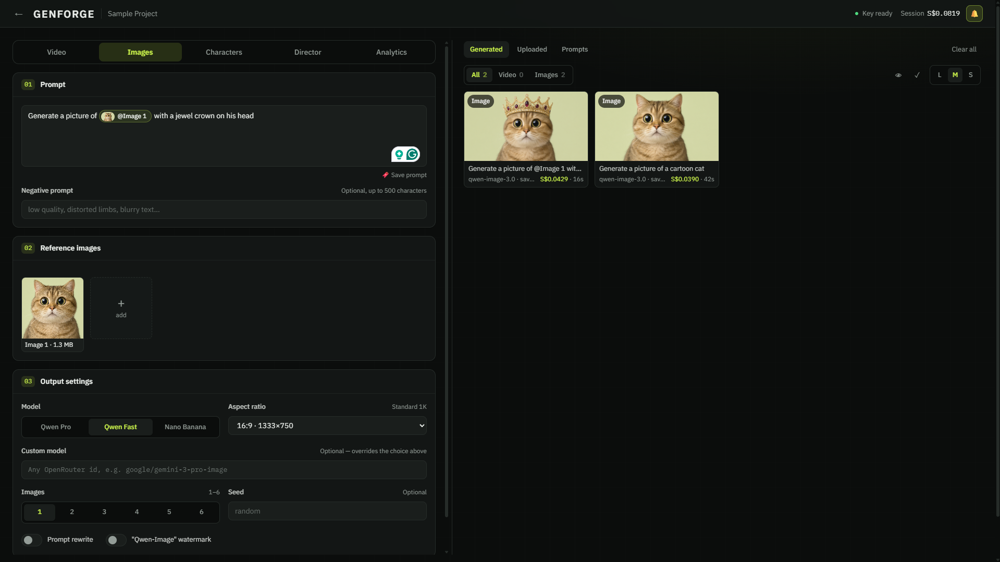

# GENFORGE

GENFORGE is a local, project-based content studio for generating and organizing images, videos, storyboards, characters, and reference media. It uses Alibaba Cloud Model Studio (DashScope) for Qwen and Wan models, optionally the Model Studio **Token Plan** subscription for HappyHorse video, Wan 2.7 Image and Qwen 3.8 Max, and OpenRouter for every other model — Veo, Kling, Seedance, Hailuo, Runway, Grok, Nano Banana, GPT Image, FLUX, Claude, GPT, Gemini and more. You pick which models appear on the **Models and API keys** page.

It is designed as an all-in-one, story-to-video workspace in the spirit of OpenArt and Higgsfield: develop a premise, turn it into a storyboard, establish reusable characters and reference media, generate images and video, then keep every output organized in the same project. Rather than moving between separate writing, image, video, and asset-management tools, GENFORGE keeps the full creative workflow in one local app.



## What it does

- Create separate projects for a shoot, client, or campaign. Each project keeps its generated assets, storyboards, characters, and uploads together. Deleting a project only makes its contents unassigned; it does not delete their files.
- On desktop widths the project studio fills the viewport: the workspace column (Video / Images / Characters / Director / Analytics) and the library column (Generated / Uploaded / Prompts) each scroll inside themselves, the page never scrolls as a whole, and the divider between them drags to resize. Below laptop width the columns stack and the page scrolls normally.
- Manage models on the **Models and API keys** page (`/models`, also in the ⚙ menu and on the projects screen): paste a key per provider, test it, turn models on or off, edit each model's limits and prices, add any other OpenRouter model from its live catalog, and choose which writing model does Director, prompt rewrite and character auto-write. The Video, Images and Director tabs only offer models that are on **and** have a key.
- Every model carries its own policy, and the panels follow it: allowed durations (a range, or fixed lengths such as Veo's 4/6/8s), resolutions, aspect ratios, whether it generates audio, first/last-frame support, how many reference images, videos and audio clips it takes and their size limits, and whether reference video eats into the output length (Wan: reference plus output must fit in 30s). The server enforces the same policy, so a bad request is rejected with a clear message before it costs anything.
- Generate videos with Wan 3.0 / Prime on DashScope (text, reference images/video/audio, **smart** duration where the model picks the length, first/last frame on the QwenCloud endpoint), HappyHorse 1.1 on the Token Plan (text-to-video, first-frame i2v, and reference-to-video with up to 9 images — no audio, 3–15s; images smaller than HappyHorse's minimum size are upscaled automatically, and ones wider than 2.5:1 are refused with a note to crop them), or, through OpenRouter, Veo 3.1 (Fast, Lite), Kling 3.0, Seedance 2.x, HappyHorse, Hailuo 3, Runway Gen-4.5 and Grok Imagine. OpenRouter's video API accepts images only, so reference video and audio are Wan-only; HappyHorse takes no video or audio references either, so its output length is never reduced by inputs. A prompt under 200 characters opens a "too short / right tool?" dialog that must be dismissed or confirmed before generating.
- Every model's input rules are checked before anything is sent, so a request the provider would reject never costs a round trip: reference images below or above a model's pixel limits are rescaled automatically, images too wide or tall for it are refused with a note to crop them, transparent images are flattened where a model can't take transparency, and a too-long prompt, a missing required image or frame, an oversized file, or a too-short reference clip is caught with a plain message. Veo's rule that 1080p, 4K, reference images and a last frame all need an 8s clip narrows the duration choice to 8s automatically. Each limit is editable under **Edit limits** on the Models page.
- Generate images with Qwen Image 3.0 (Pro and Fast), Wan 2.7 Image Pro and Qwen Image 2.0 Pro on the Token Plan (Team Edition), or, through OpenRouter, Nano Banana 2 / Pro, GPT Image 2, Seedream 5, FLUX.2 Pro, Grok Imagine Image and Recraft.
- Keep a character library with reference images, an optional voice sample, and a reusable description. Mention a character by name (or as an `@` chip) in a video or image prompt and its reference media and identity-binding prompt text are attached automatically at rewrite and at submit. Saved characters carry **Edit**, **Add look**, **Move or copy**, **Hide/Unhide** and **Delete**: a hidden character stays in this list but stops appearing in `@` mentions and reference picking, so it drops out of video/image references without being deleted.
- Give a character several **looks** — an outfit, age or styling, each with its own description and reference images — while the name and voice stay shared. Exactly one look is active at a time: pick it from the look pills on the saved character (or **Make active** while editing), and every reference to that character, in Video, Images, Rewrite and Director, uses only that look's description and images. References already attached in the Video panel are swapped to the active look when you rewrite or generate.
- Use Director to turn a premise and cast into a storyboard in your house style, then revise and save versions. Each storyboard shows the prompt that produced it above the script — the premise, and for a revision the amendment you typed plus a button to open the version it revised (storyboards made before this was added only kept the first 120 characters of the premise and no amendment). Each storyboard remembers where you scrolled to, so switching tabs (or reloading) brings you back to the line you were reading. Video Prompt Rewrite formats a prompt and its attached material into a structured Wan reference-to-video request; characters mentioned by name are attached automatically so their references are included in the rewrite and the generation. A rewrite runs on the server as a saved job, so reloading the page, switching projects or closing the tab does not lose it — reopen the project and the panel picks the result up (and restores the prompt it was written from). A **Think** toggle beside ✦ Rewrite turns the model's reasoning mode on for harder prompts; it is off by default because a normal rewrite takes a few seconds while a thinking one can take 40–160s. If the server is restarted mid-rewrite the job is marked interrupted and you are asked to press Rewrite again.
- Paste a screenshot straight in: Ctrl+V anywhere in the studio saves images (or audio) from the clipboard into the upload library and switches to the Uploaded pane, ready to drag into a reference zone. Pasting text into a prompt is unaffected.
- Watch a result in the detail view with a frame-accurate `ss:cs` timecode. One row of buttons under the player holds every action: **Download frame** (the frame on screen, full-resolution PNG), **Frame to Uploaded**, **Download video**, **Copy file** (Windows: puts the actual file on the clipboard for Ctrl+V into Clipchamp), **Show in Explorer** and **Reuse settings**. Dragging the picture out to Explorer still works; dragging the player's own scrubber or volume slider seeks instead. The player's volume — its slider or the native controls' — is remembered per browser and shared by every player, so a level you set once sticks.
- Open a card's **expand prompt** to read the prompt in full; when a video was generated after a rewrite, the original and the rewritten text are both shown complete, with a badge on the one that was actually sent. The card's mono params row (resolution, ratio, duration…) drops `duration` once the card is older than a day.
- Hide clutter without losing it: 👁 on a gallery tile removes an asset from the grid while keeping every file on disk, and the eye button next to the thumbnail-size controls reveals hidden assets again (hidden ones stay out of the grid by default on every load).
- Keep favourites in reach: 📌 on a gallery tile pins it to the top of the Generated grid (marked with an accent border). Pinned assets come first, then anything still generating, then the rest by date. Pins persist across reloads.
- Save generated results and uploaded image/audio files locally, browse them in the asset library, download or reuse generation settings, and move/copy items between projects. Every tile carries a lime **Video** or sky **Image** badge so the two read apart at a glance, and submitting a generation flips the right pane back to **Generated** so the new job is immediately visible. On Windows, 📋 on a gallery tile copies the actual file to the clipboard under a neutral name (`genforge-<date>-<id>.mp4`, revealing nothing about the prompt), so it can be pasted straight into another app; 📂 shows it in Explorer.
- See what your kept footage really costs: copying a video file out (📋) marks it **used**, and Analytics reports the **video cost per used minute** — every generated video's cost in the period divided by the total minutes of videos you actually used (10 videos at $2 with only 5 copied out, 30s each = $20 ÷ 2.5 min = $8/min).
- Review estimated, not authoritative, costs for assets and Director/Rewrite runs in Analytics, scoped to the current project or to all projects. The report reloads every time you open the Analytics tab and whenever you return to the window while it is open, so it never needs a page refresh. Rates are set per model on the Models page; where OpenRouter reports the actual charge, that is used instead. Deleting an asset does not erase its cost: the amount already spent stays in the report, marked **deleted**, so totals never shrink retroactively (only assets deleted after this was added are covered).
- Open the **⚙ settings** menu in the header for **Notifications** and **Volume**. Notifications has a master switch — a chime, a desktop notification and a tab-title badge when work finishes while the window is not focused — plus a switch per kind of work: video generations, image generations, prompt rewrites and Director storyboards. Volume sets the video playback level shared by every player and the alert chime level, with a button to hear it. Everything is remembered per browser; if you decline the browser's notification prompt, the chime and title badge still work.

Generated media, references, characters, projects, uploads, and analytics records are stored under `data/`, which is intentionally ignored by Git. Generated results are downloaded into the asset library so they remain available after a provider URL expires. Pending video jobs and in-flight prompt rewrites are persisted and resume after a page reload.

## Quick start

Prerequisites: Node.js 20 or newer, and a DashScope key (for Qwen/Wan), an OpenRouter key (for everything else), and/or a Token Plan key starting with `sk-sp-` (Singapore-only subscription; for HappyHorse, Wan 2.7 Image and Qwen 3.8 Max on Credits).

1. Install dependencies:

   ```bash
   npm install
   ```

2. Start the development server:

   ```bash
   npm run dev
   ```

3. Open [http://localhost:3000/models](http://localhost:3000/models), paste your keys and turn on the models you want. Then go back, create a project, and open it to begin generating.

## Configuration

All settings live in **`genforge.config.json`** in the project folder. It is created with defaults on first run, is gitignored, and is re-read whenever it changes, so edits (from the Models page or by hand) apply without a restart. `genforge.config.example.json` is the committed template with the full researched catalog and empty keys — copy it to `genforge.config.json` if you prefer to edit by hand. `.env.local` is no longer read.

| Section | What it holds |
| --- | --- |
| `providers.dashscope` | DashScope key and base URL. Keys are region-locked: Singapore uses `https://dashscope-intl.aliyuncs.com` (default), Beijing `https://dashscope.aliyuncs.com`. |
| `providers.qwencloud` | Optional QwenCloud key and base URL, used for Wan video when `videoProvider` is `qwencloud` (enables first/last-frame mode). |
| `providers.openrouter` | OpenRouter key and base URL; serves every model whose id looks like `vendor/model`. |
| `providers.tokenplan` | Model Studio Token Plan key (`sk-sp-…`) and base URL (`https://token-plan.ap-southeast-1.maas.aliyuncs.com`). Singapore-only subscription billed in Credits; the USD prices on Token Plan models are pay-as-you-go equivalents for estimates. Keys and URLs are not interchangeable with `providers.dashscope`. |
| `roles` | Writing model for `director` (default), `rewrite` and `appearance` (must read images). |
| `models[]` | One entry per model: `id`, `label`, `kind` (`video`, `image`, `text`), `provider`, `enabled`, `policy` (limits), `pricing` (USD estimates) and `notes`. |

Video `policy` fields: `durations` (`{min,max}` or `{values:[…]}`), `smartDuration`, `resolutions`, `ratios`, `audio`, `frames`, `framesRequireQwencloud`, `seed`, `watermark`, and `refs` — `maxImages`, `maxVideos`, `maxVideoTotalSec`, `maxAudio`, `maxAudioSec`, the `max*MB` size limits, `videoCountsTowardDuration` with `totalBudgetSec`, and `framesExclusiveWithRefs`. Image `policy`: `maxRefs`, `maxRefMB`, `maxN`, `sizes`, `negativePrompt`, `promptExtend`, `watermark`, `seed`. Text `policy`: `vision`, `maxTokens`. Prices are `perSecond` / `perSecondNoAudio` (keyed by resolution or `default`), `perImage` / `perInputImage`, or `per1KInput` / `per1KOutput`.

Keys never leave the server: the page only ever sees whether a key is set and its last four characters.

## Committing safely

This repository is public and `data/` holds personal material (generated videos, character reference photos and voice samples, uploads, analytics). A pre-commit hook in `.githooks/` refuses any commit that stages a path under `data/`, `genforge.config.json`, any `.env` file, private-key material, or a line that looks like a live API key.

Enable it once per clone:

```bash
git config core.hooksPath .githooks
```

If you ever need to get past it deliberately, `git commit --no-verify`.

## Development and local servers

```bash
npm run dev       # development server on http://localhost:3000
npm run dev2      # second development server on http://localhost:3001
npm run lint      # ESLint
npx tsc --noEmit  # TypeScript check
```

`npm run build` writes the production build to `.next-prod`; `npm run start` serves that build on port 3000. Use the development server for normal local work. If port 3000 is already running the production app, use `npm run dev2` and test at [http://localhost:3001](http://localhost:3001) instead.

If generated Next.js route helper types are missing, run:

```bash
npx next typegen
```

## Server API overview

The browser never calls model providers directly: all requests go through Next.js route handlers so API keys stay on the server.

| Area | Routes |
| --- | --- |
| Configuration | `GET /api/config` (available models, no keys), `GET`/`PUT /api/models` (the Models page), `POST /api/models/test` (check a key), `GET /api/models/openrouter-catalog` (drafts from OpenRouter's live catalog) |
| DashScope + Token Plan generation | `POST /api/generate/image`, `POST /api/generate/video`, `GET /api/task/[id]` (Token Plan video polls with `?provider=tokenplan`) |
| OpenRouter generation | `POST /api/generate/openrouter`, `POST /api/generate/openrouter-video`, `GET /api/task/[id]?provider=openrouter` |
| Reference-media transfer | `POST /api/upload` for temporary provider uploads; `GET`/`POST`/`DELETE /api/uploads` for the local upload library |
| Assets | `GET`/`POST`/`DELETE /api/assets`, item/result routes under `/api/assets/[id]`, plus bulk move/copy and completion/failure routes |
| Projects | `GET`/`POST /api/projects`, `PATCH`/`DELETE /api/projects/[id]` |
| Characters | `GET`/`POST /api/characters`, `PATCH`/`DELETE /api/characters/[id]` (edits one look via `lookId`, or `lookId=new` to add one; `activeLook` / `deleteLook`), and stored image (`?look=`) / audio routes |
| Writing and reporting | `GET`/`POST /api/director`, `POST /api/director/bulk`, `GET`/`POST /api/rewrite-prompt` plus `GET /api/rewrite-prompt/[id]` and `POST /api/rewrite-prompt/[id]/ack`, `POST /api/appearance`, `GET /api/analytics` |

Long-running video jobs use an asynchronous create-and-poll flow. The app creates a pending local asset before submission, polls the provider through `/api/task/[id]`, and finalizes or marks the local asset failed when a result arrives.

## Project structure

```text
src/app/          App Router pages and server API routes
src/components/   Studio panels, galleries, prompt editor, and UI primitives
src/lib/          Provider clients, persistence, pricing, project, and type helpers
data/             Local runtime storage (gitignored)
genforge.config.example.json   Configuration template (no keys)
```

The stack is Next.js 16.3.4, React 19, TypeScript, and Tailwind CSS v4.
